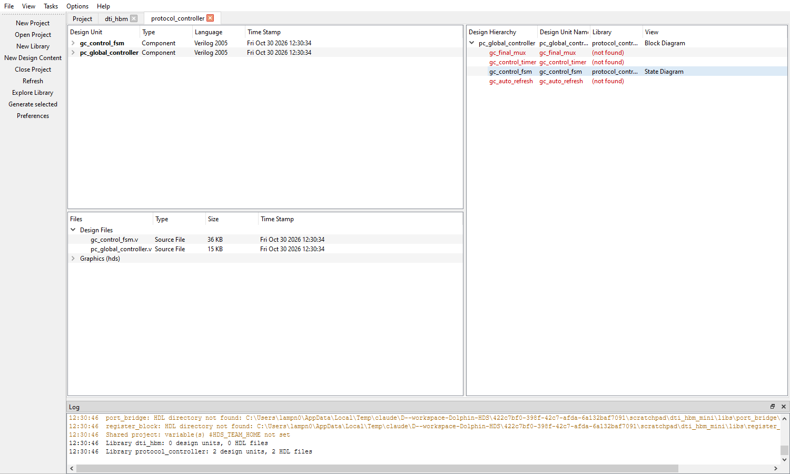

# Vietsemi HDL Studio

**Vietsemi HDL Studio** is the RTL design and verification tool of [Vietsemi](https://vietsemi.org),
the front-end companion of **V-Layout**. It is a design manager and graphical HDL editor for
**Verilog and SystemVerilog**, compatible with Siemens EDA **HDL Designer Series (HDS)** projects. It opens HDS projects (`.hdp`), browses their
libraries and design units, edits state diagrams and block diagrams, edits HDL text, and
generates the same Verilog / SystemVerilog that HDS generates from the same diagrams.

Written in Python with PySide6 (Qt 6); runs on Windows and CentOS Stream 9.
Version 1.0.0 (`src/version.py`, which also holds the product name used everywhere in the tool).
User settings live in `~/.config/vietsemi-hdl-studio`; a configuration left by the
prototype ("Dolphin HDS", `~/.config/dolphin-hds`) is moved there on the first start.



## What it does

| | |
|---|---|
| **Projects** | Open / create `.hdp` projects in the HDS format, with shared team projects, regular and protected libraries, environment variables in paths. |
| **Design Manager** | Libraries in tabs: Design Units (with views and default view), Files (parse errors in red), Design Hierarchy (generate frames, missing units). Session restore and crash recovery. |
| **State diagram editor** | States, transitions, junctions, links, clock / reset / recovery / interrupt points, hierarchical states, declaration blocks, HDS dialogs and popup menus. Reads and **writes back the HDS `.sm`**, so HDS and HDL Studio edit the same file. |
| **Block diagram editor** | Components (Component Browser), nets and buses, port I/Os, embedded HDL blocks, FOR / IF / ELSE generate frames, routing, HDS dialogs and popup menus. Reads the HDS `.bd`. |
| **HDL text editor** | Line numbers, find / replace, syntax check with slang. |
| **Generation** | Verilog-2005 / SystemVerilog, identical to HDS's output; through blocks, components or the design root; hand-edited files are never overwritten without asking. |

What is not done yet is listed in [docs/roadmap.md](docs/roadmap.md).

## Quick start

```
pip install -r requirements.txt
python bin/hdlstudio.py                               # Design Manager (reopens the last session)
python bin/hdlstudio.py examples/uart_hds/uart.hdp    # open the example project
```

On CentOS Stream 9 install the Qt xcb libraries first (see
[docs/development.md](docs/development.md)), then use `python3` or `bin/hdlstudio.sh`.
On Windows `bin\hdlstudio.bat` starts the tool without a console window.
Set the environment variables your projects use (`$HDS_TEAM_HOME`, ...) as for HDS.

The [user guide](docs/user-guide.md) explains the daily work: projects, libraries, the
editors, generation, sessions and locks.

## Repository layout

The layout follows the HDS installation (`C:\MentorGraphics\HDS_2021.1`: `bin`, `docs`,
`examples`, `resources`, `hdl_libs`):

```
hdl-studio/
├── bin/            launchers: hdlstudio.py (Design Manager), fsm_editor.py, .bat / .sh wrappers
├── src/            the application code (on sys.path: modules imported by their own names)
│   ├── model.py, bd_model.py    data model of state diagrams and block diagrams
│   ├── hds/                     HDS file formats: .sm / .bd / .sb readers and writers
│   ├── hdl/                     Verilog / SystemVerilog parser (pyslang)
│   ├── codegen/                 HDL generators (state machine, block diagram)
│   ├── project/                 .hdp projects, libraries, generation, locks, templates
│   ├── prefs.py, session.py     preferences, session, autosave
│   ├── version.py               version number
│   └── gui/                     Qt user interface: Design Manager, editors, dialogs
├── libs/           HDL libraries shipped with the tool (HDS library layout)
├── resources/      images/ (screenshots), drawings/ (doc diagrams), scripts/ (packaging)
├── examples/       example HDS projects (UART made with HDS, and rebuilt with HDL Studio)
├── tests/          unit tests, GUI tests, comparisons with HDS (tests/README.md)
├── docs/           requirements, architecture, file formats, guides (docs/README.md)
├── requirements.txt
└── LICENSE
```

## Documentation

* [docs/README.md](docs/README.md) - index of all documents
* [docs/architecture.md](docs/architecture.md) - how the code is organised; read before changing it
* [docs/development.md](docs/development.md) - set-up, conventions, tests, packaging
* [docs/user-guide.md](docs/user-guide.md) - using the tool
* [docs/requirements.md](docs/requirements.md) - requirements specification
* [tests/README.md](tests/README.md) - the tests and what they need

Every module, class and function of `src/` carries an English docstring; the module
docstrings are the best entry point into each part of the code.

## Tests

```
python -m unittest discover -s tests       # unit tests, including golden HDL comparisons
python tests/gui/run_all.py                 # GUI tests: real windows, mouse and keyboard
```

Comparisons with the real HDS (batch generation, round trips through `.sm` files) are in
`tests/hds_compare/` and `tests/hds_sync/`; see [tests/README.md](tests/README.md).

## Building a release

```
powershell -ExecutionPolicy Bypass -File resources\scripts\build_windows.ps1
bash resources/scripts/build_linux.sh
```

Both use PyInstaller (`pip install pyinstaller`) and write `dist/HDLStudio/` plus an archive.

## License

GNU General Public License v3.0 - see [LICENSE](LICENSE). (c) Vietsemi.

## Trademarks

Vietsemi HDL Studio is developed by Vietsemi. It is **not affiliated with, endorsed by or
sponsored by Siemens EDA**. HDL Designer Series (HDS) and HDL Designer are trademarks of
Siemens; they are named here only to describe file-format compatibility.
