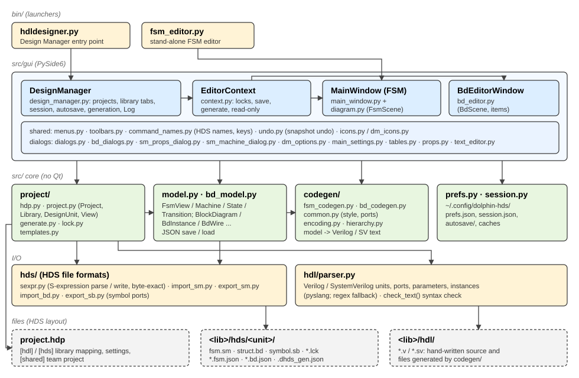

# HDLDesigner architecture

How the code is organised and how data flows through it. Read this before changing the code;
the docstrings of each module go into the details.

## 1. Principles

1. **HDL is the source of truth.** Generated Verilog / SystemVerilog lives in the library's
   `hdl/` folder like hand-written code; diagrams are a way to produce it.
2. **Same files as HDS.** Projects (`.hdp`), library folders (`<lib>/hdl`, `<lib>/hds/<unit>/`),
   state diagrams (`.sm`), block diagrams (`.bd`), symbols (`.sb`) and locks (`.lck`) are read in
   the HDS formats, so a team can use both tools on one project. State diagrams are written back
   into the `.sm` they came from; block diagrams are saved as `struct.bd.json` next to the `.bd`
   (see [roadmap.md](roadmap.md)).
3. **Same output as HDS.** The generators reproduce HDS's text layout exactly (order of
   declarations, indentation, comments), checked against HDS itself (`tests/hds_compare/`).
4. **Same behaviour as HDS.** Menus, shortcuts, popup menus, dialogs and editing gestures follow
   HDS 2021.1 as observed ([hds-observations.md](hds-observations.md)); comments in the code that
   say "as HDS does" record such an observation. Commands not implemented yet are shown greyed
   at their HDS place.
5. **Verilog and SystemVerilog only** (no VHDL), Windows and CentOS Stream 9.

## 2. Module map (`src/`)

`src/` is the top level of the code: `bin/` puts it on `sys.path`, so modules are imported by
their own names (`from model import FsmView`, `from gui.bd_editor import BdEditorWindow`).
Inside a sub-package, modules import each other relatively (`from .icons import icon`).

| Module | Responsibility |
|---|---|
| `model.py` | State diagram data model: `FsmView` (one view) > `Machine` > `State`, `Junction`, `Link`, `Point`, `Transition`; `Signal`, `Parameter`. JSON save / load. |
| `bd_model.py` | Block diagram data model: `BlockDiagram` > `BdInstance` (+ `BdPin`), `BdEmbedded`, `BdPortIo`, `BdWire`, `BdFrame`, `BdComment`, `BdJunction`. |
| `hds/sexpr.py` | Parser / writer of the S-expression text of `.sm` / `.bd` / `.sb`. Writing back an unchanged document gives the same bytes. |
| `hds/import_sm.py`, `hds/import_bd.py` | HDS file -> model. Keep HDS geometry in the `hds` dicts of the model objects. |
| `hds/export_sm.py` | Model -> `.sm`: re-reads the original file and changes only what was edited. |
| `hds/export_sb.py` | Keeps a unit's `symbol.sb` ports in step with its diagram's ports. |
| `hdl/parser.py` | Units, ports, parameters and instances of HDL files (pyslang); syntax check of editor text. |
| `codegen/fsm_codegen.py`, `codegen/bd_codegen.py` | Model -> HDL text. `common.py` holds the shared formatting and the generation style (Options > Verilog > Style). |
| `codegen/encoding.py`, `codegen/hierarchy.py` | State encodings; flattening of hierarchical states before generation. |
| `project/hdp.py`, `project/project.py` | `.hdp` reading / writing; `Project`, `Library`, `DesignUnit`, `View`; library scanning. |
| `project/generate.py` | Generate a unit's file into its library, with overwrite protection. |
| `project/lock.py`, `project/templates.py` | Edit locks; content of new design units. |
| `prefs.py`, `session.py` | User preferences; saved session, autosave of unsaved work. |
| `gui/design_manager.py` | The Design Manager window, and the coordinator of the application. |
| `gui/context.py` | `EditorContext`: what an editor knows about the project (locks, save, generate). |
| `gui/main_window.py`, `gui/diagram.py` | State diagram editor window and its canvas / items. |
| `gui/bd_editor.py` | Block diagram editor window, canvas, items and routing. |
| `gui/text_editor.py` | HDL text editor. |
| `gui/menus.py`, `gui/toolbars.py`, `gui/command_names.py` | Menu bars, toolbars, HDS command names, tool tips and shortcuts. |
| `gui/undo.py` | Snapshot undo / redo; per-view zoom and scroll memory. |
| other `gui/*` | Dialogs and panels (see each module's docstring). |

The layers only call downwards: `gui` uses everything, `project` uses `hds`, `hdl` and
`codegen`, the models use nothing. Everything outside `gui/` runs without Qt, so scripts and
tests can open projects, read diagrams and generate HDL directly.

## 3. Data model

* Coordinates are **scene units** = HDS units / 75 (`hds.import_sm.SCALE`). The editors' grid is
  1000 HDS units (`gui.diagram.GRID`).
* Objects read from an HDS file have the id `n<label>` (the `*N` label in the file), which lets
  `export_sm` find the original object again. New objects get other ids until they are saved.
* HDS geometry that the model does not need for generation (text boxes, line positions, ...) is
  kept in each object's `hds` dict. The editors draw from it while the object's texts are still
  the ones it was saved with (`hds['sig']`); after an edit they lay the object out themselves.
* A block diagram net is the set of `BdWire`s with the same `net` name plus the `Signal` of that
  name (type, bounds). Wire ends are attached with references: `pin:<instance id>:<pin>`,
  `pio:<id>`, `emb:<id>`, `jct:<id>`, or '' for a dangling end.

## 4. Main flows

### Opening a project
`DesignManager.load_project` -> `project.open_project` reads the `.hdp` (and the shared `.hdp`),
creates the `Library` objects and reports problems (unset variables, missing folders) in the
Log. A library is scanned (`Library.scan`) when its tab is opened: HDL files are parsed (cached
by modification time, the cache is kept between runs), graphics folders give the views.

### Opening and editing a view
`DesignManager.open_view` -> `project.generate.load_view` reads the view (`import_sm` /
`import_bd`, or the `.json`) -> an `EditorContext` locks it (`.lck`) -> the editor window
(`MainWindow` or `BdEditorWindow`) is created with the model and the context.

In the editor the scene (`FsmScene` / `BdScene`) edits the model objects directly and emits
`changed_model`. The window then marks itself dirty, lets `SnapshotUndo` take a snapshot (a
burst of edits is one undo step) and regenerates the HDL in memory after a short delay (for
warnings and the design rule check).

### Saving
`EditorContext.save`: a state diagram read from a `.sm` is written back with
`export_sm(view, src, dst, geometry)` (the editor passes the lines as drawn); its symbol is
updated when the ports changed. Other views are saved as `<view>.<kind>.json`.

### Generating
`gui.context.generate_with_prompt` -> `project.generate.generate_unit`: the header comes from the
preferences, the text from `codegen`, the file name from the naming rule. The hash of every file
written is kept in `hds/<unit>/.dhds_gen.json`; a file whose content no longer matches was
edited by hand, so the user is asked before it is overwritten. Tasks > Generate through
blocks / components / design root walks the hierarchy (`EditorContext.generate_hierarchy`).

### Session and crash protection
`DesignManager.session_snapshot` records the project, library tabs and editor windows; it is
saved whenever editor windows or library tabs open and close (and at exit, with the window
places), and restored at start-up. Every N minutes the
unsaved model of each editor is written to the autosave folder; opening a view with an
autosave offers to recover it.

## 5. Where things are configured

| What | Where |
|---|---|
| User preferences (Options dialogs) | `~/.config/dolphin-hds/prefs.json` (`$XDG_CONFIG_HOME` if set) |
| Session, autosave, caches | the same folder: `session.json`, `autosave/`, `hdl_cache.pickle`, `hier_cache_v2.json` |
| Zoom / scroll per diagram | Qt settings ("Dolphin" / "HDS") |
| Project and libraries | the `.hdp` file |
| Default views of a library | `<lib>/hds/.dhds_default_views.json` |
| Generation records | `<lib>/hds/<unit>/.dhds_gen.json` |

## 6. Extending the tool

* **A new editor command:** create the action in the editor's `_build_actions` /
  `_build_menu_commands` under a key; give the key its HDS name, tool tip and status text in
  `gui/command_names.py`, its shortcut in `gui/toolbars.py` (`FSM_KEYS` / `BD_KEYS`), and its
  place in `gui/menus.py` (`@key`). An entry that exists in HDS but not yet here is a plain text
  item in `menus.py`: it is shown greyed.
* **A generation rule:** change `codegen/`, then run the unit tests and the HDS comparison
  (`tests/hds_compare/compare.py`): the output must stay identical to HDS's.
* **Another HDS object in a `.sm`:** read it in `hds/import_sm.py` (keep its geometry in `hds`),
  write it in `hds/export_sm.py` (from the templates the file holds), draw it in
  `gui/diagram.py`; check with `tests/hds_compare/sm_write.py` and `tests/hds_sync/sync_fsm.py`.
* **A preference:** add a field with a default to `prefs.Prefs` (old preference files keep
  working), a widget to the dialog, and read it where it is used.

See [development.md](development.md) for the working conventions and the tests.
